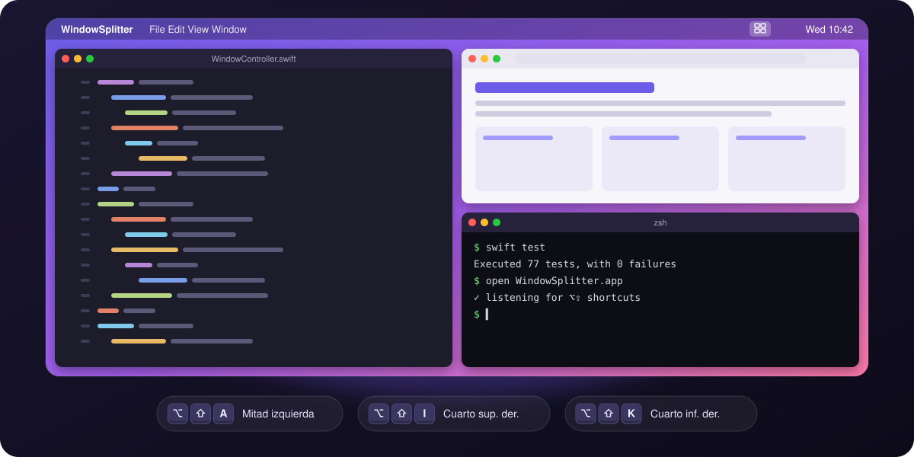
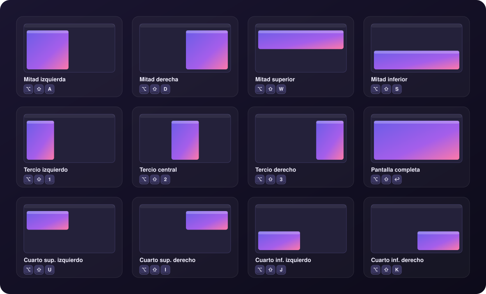
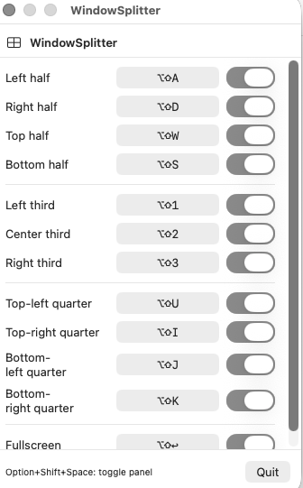
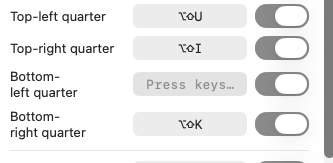

<p align="center">
  
</p>

<h1 align="center">WindowSplitter</h1>

<p align="center">
  <a href="README.md">English</a> · <b>Español</b>
</p>

<p align="center">
  <b>Acomoda cualquier ventana de macOS en mitades, tercios o cuartos con un atajo de teclado.</b><br>
  Vive en la barra de menús, pesa casi nada y no te estorba.
</p>

<p align="center">
  
  
  
  
</p>

---

## ✨ Qué hace

- **12 layouts** listos: mitades, tercios, cuartos y pantalla completa.
- **Atajos globales** que funcionan en cualquier app, sin tener que cambiar de ventana.
- **Atajos configurables:** grabas el tuyo con un clic y lo activas o desactivas con un switch.
- **Vive en la barra de menús:** no aparece en el Dock ni en ⌘Tab.
- **Respeta el Dock y la barra de menús:** usa solo el área visible de la pantalla donde está la ventana.
- **Sin dependencias:** Swift puro con AppKit, SwiftUI y la API de Accesibilidad de macOS.

## ⌨️ Layouts y atajos

Todos usan **⌥ Option + ⇧ Shift** + una tecla:

<p align="center">
  
</p>

| Atajo | Layout | | Atajo | Layout |
|:---:|---|---|:---:|---|
| `⌥⇧A` | Mitad izquierda | | `⌥⇧U` | Cuarto superior izquierdo |
| `⌥⇧D` | Mitad derecha | | `⌥⇧I` | Cuarto superior derecho |
| `⌥⇧W` | Mitad superior | | `⌥⇧J` | Cuarto inferior izquierdo |
| `⌥⇧S` | Mitad inferior | | `⌥⇧K` | Cuarto inferior derecho |
| `⌥⇧1` | Tercio izquierdo | | `⌥⇧↩` | Pantalla completa |
| `⌥⇧2` | Tercio central | | | |
| `⌥⇧3` | Tercio derecho | | `⌥⇧Space` | **Abrir / cerrar el panel** |

> [!TIP]
> Las teclas W A S D forman una cruz en el teclado, igual que en los videojuegos. U I J K son los cuatro cuartos de la pantalla en la misma posición en la que están las teclas.

## 🎛️ Panel de configuración

Haz clic en el icono de la barra de menús o pulsa `⌥⇧Space` para abrir el panel. Ahí ves todos los atajos, los activas o desactivas y los cambias.

<table>
  <tr>
    <td align="center" width="55%">
      <br>
      <sub>Todos los layouts con su atajo y su switch</sub>
    </td>
    <td align="center" width="45%">
      <br>
      <sub>Haz clic en un atajo y pulsa la combinación nueva.<br><kbd>Esc</kbd> cancela.</sub>
    </td>
  </tr>
</table>

Los atajos se guardan en `UserDefaults`, así que se conservan al reiniciar.

## 📦 Instalación

### Requisitos

- macOS 13 Ventura o superior
- Xcode 15 o superior
- [XcodeGen](https://github.com/yonaskolb/XcodeGen), que genera el `.xcodeproj` a partir de `project.yml`:
  ```bash
  brew install xcodegen
  ```

### 1. Clonar y generar el proyecto

```bash
git clone https://github.com/ShadowNox96/window-spliter-mac.git
cd window-spliter-mac
xcodegen generate
```

### 2. Compilar en modo Release

```bash
xcodebuild -project WindowSplitter.xcodeproj -scheme WindowSplitter -configuration Release -derivedDataPath build build
```

### 3. Instalar en Aplicaciones

```bash
cp -R build/Build/Products/Release/WindowSplitter.app /Applications/
open /Applications/WindowSplitter.app
```

### 4. Dar permiso de Accesibilidad

WindowSplitter necesita este permiso para escuchar los atajos y mover ventanas de otras apps.

1. Abre **Ajustes del Sistema → Privacidad y seguridad → Accesibilidad**.
2. Activa **WindowSplitter**. Si no aparece en la lista, añádela con **+** desde `/Applications`.
3. No hace falta reiniciar la app: detecta el permiso sola en un segundo.

### 5. (Opcional) Abrirla al iniciar sesión

**Ajustes del Sistema → General → Ítems de inicio de sesión → +** y elige WindowSplitter.

## 🔄 Actualizar

```bash
git pull
xcodegen generate
xcodebuild -project WindowSplitter.xcodeproj -scheme WindowSplitter -configuration Release -derivedDataPath build build
rm -rf /Applications/WindowSplitter.app
cp -R build/Build/Products/Release/WindowSplitter.app /Applications/
tccutil reset Accessibility com.local.WindowSplitter
open /Applications/WindowSplitter.app
```

Después vuelve a activar el permiso de Accesibilidad (paso 4).

> [!IMPORTANT]
> **¿Por qué hay que volver a dar el permiso?** La app se firma localmente ("ad-hoc"), sin certificado de desarrollador. Para macOS, cada build nueva es una app distinta, así que el permiso viejo deja de valer aunque el switch siga encendido en Ajustes. Si añades tu Apple ID como *Team* en Xcode (Signing & Capabilities), la firma no cambia entre builds y el permiso se mantiene.

## 🩺 Solución de problemas

| Síntoma | Solución |
|---|---|
| Los atajos no hacen nada | El permiso de Accesibilidad pertenece a otra build. Ejecuta `tccutil reset Accessibility com.local.WindowSplitter`, abre la app y vuelve a dar el permiso. |
| El panel no abre con `⌥⇧Space` | Comprueba que la app esté corriendo: el icono ⊞ debe aparecer en la barra de menús. |
| Un atajo choca con otra app | Abre el panel, haz clic en el atajo y graba otra combinación, o desactívalo con su switch. |
| Una ventana no se mueve | Algunas ventanas tienen tamaño fijo o no exponen Accesibilidad, como ciertos diálogos del sistema. |

## 🛠️ Desarrollo

```bash
xcodegen generate
open WindowSplitter.xcodeproj   # ⌘R para ejecutar, ⌘U para tests
```

O desde la terminal:

```bash
xcodebuild test -project WindowSplitter.xcodeproj -scheme WindowSplitter -destination 'platform=macOS'
```

### Estructura

```
WindowSplitter/
├── AppDelegate.swift              # Icono en la barra de menús, panel y ciclo de vida
├── WindowSplitterApp.swift        # Entry point
├── Engine/
│   └── GlobalHotkeyManager.swift  # CGEventTap global + vigilancia del permiso
├── Models/
│   └── WindowAction.swift         # Los 12 layouts, sus atajos y su geometría
├── Store/
│   └── SettingsStore.swift        # Atajos guardados en UserDefaults
├── UI/
│   ├── ConfigPanelView.swift      # Panel de configuración
│   ├── ShortcutRowView.swift      # Fila: nombre + atajo + switch
│   └── ShortcutRecorderButton.swift  # Captura de combinaciones de teclas
└── Window/
    └── WindowController.swift     # Mueve y redimensiona ventanas con AXUIElement
```

### Cómo funciona

1. `GlobalHotkeyManager` crea un `CGEventTap` que escucha las teclas pulsadas en todo el sistema.
2. Si la combinación coincide con un atajo activo, se queda con el evento para que no llegue a la app de enfrente.
3. `WindowController` busca la ventana enfocada con la API de Accesibilidad (`AXUIElement`), calcula el rectángulo del layout dentro del `visibleFrame` de su pantalla y le aplica posición y tamaño.
