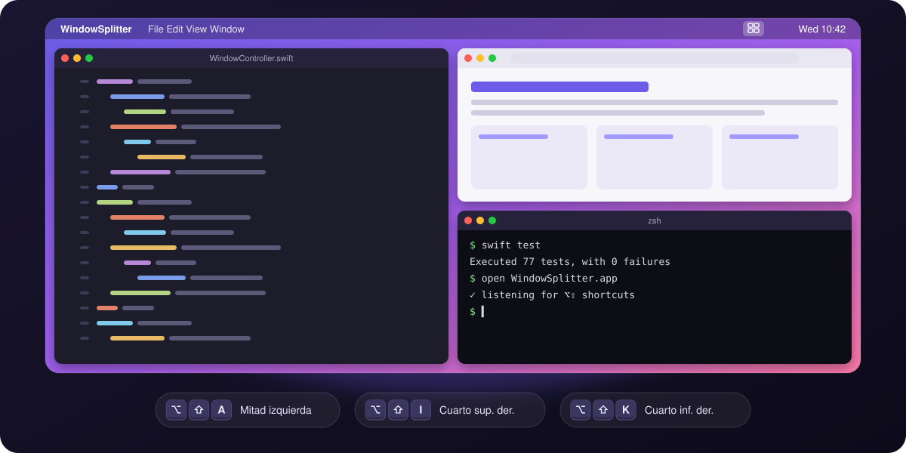
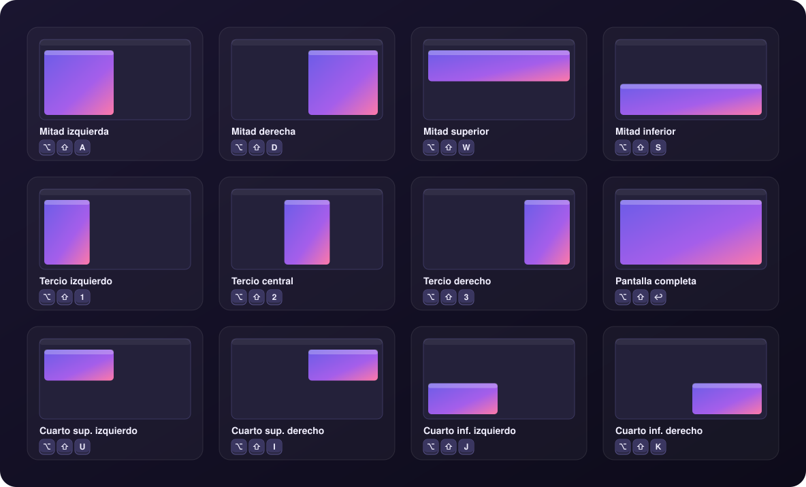
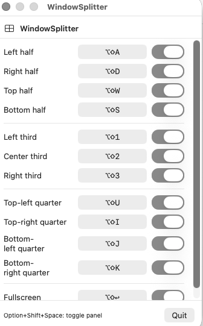
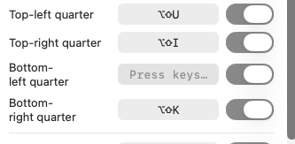

<p align="center">
  
</p>

<h1 align="center">WindowSplitter</h1>

<p align="center">
  <b>English</b> · <a href="README.es.md">Español</a>
</p>

<p align="center">
  <b>Snap any macOS window into halves, thirds or quarters with a keyboard shortcut.</b><br>
  It lives in the menu bar, weighs almost nothing and stays out of your way.
</p>

<p align="center">
  
  
  
  
</p>

---

## ✨ Features

- **12 ready-made layouts:** halves, thirds, quarters and fullscreen.
- **Global shortcuts** that work in any app, without switching windows.
- **Customizable shortcuts:** record your own with one click and turn each one on or off with a switch.
- **Lives in the menu bar:** it doesn't show up in the Dock or in ⌘Tab.
- **Respects the Dock and the menu bar:** it only uses the visible area of the screen the window is on.
- **No dependencies:** pure Swift with AppKit, SwiftUI and the macOS Accessibility API.

## ⌨️ Layouts and shortcuts

Every shortcut is **⌥ Option + ⇧ Shift** + a key:

<p align="center">
  
</p>

| Shortcut | Layout | | Shortcut | Layout |
|:---:|---|---|:---:|---|
| `⌥⇧A` | Left half | | `⌥⇧U` | Top-left quarter |
| `⌥⇧D` | Right half | | `⌥⇧I` | Top-right quarter |
| `⌥⇧W` | Top half | | `⌥⇧J` | Bottom-left quarter |
| `⌥⇧S` | Bottom half | | `⌥⇧K` | Bottom-right quarter |
| `⌥⇧1` | Left third | | `⌥⇧↩` | Fullscreen |
| `⌥⇧2` | Center third | | | |
| `⌥⇧3` | Right third | | `⌥⇧Space` | **Show / hide the panel** |

> [!TIP]
> W A S D form a cross on the keyboard, just like in video games. U I J K map to the four quarters of the screen in the same positions as the keys.

## 🎛️ Settings panel

Click the menu bar icon or press `⌥⇧Space` to open the panel. There you can see every shortcut, turn it on or off, and change it.

<table>
  <tr>
    <td align="center" width="55%">
      <br>
      <sub>Every layout with its shortcut and switch</sub>
    </td>
    <td align="center" width="45%">
      <br>
      <sub>Click a shortcut and press the new combination.<br><kbd>Esc</kbd> cancels.</sub>
    </td>
  </tr>
</table>

Shortcuts are saved in `UserDefaults`, so they survive restarts.

## 📦 Installation

### Requirements

- macOS 13 Ventura or later
- Xcode 15 or later
- [XcodeGen](https://github.com/yonaskolb/XcodeGen), which generates the `.xcodeproj` from `project.yml`:
  ```bash
  brew install xcodegen
  ```

### 1. Clone and generate the project

```bash
git clone https://github.com/ShadowNox96/window-spliter-mac.git
cd window-spliter-mac
xcodegen generate
```

### 2. Build in Release mode

```bash
xcodebuild -project WindowSplitter.xcodeproj -scheme WindowSplitter -configuration Release -derivedDataPath build build
```

### 3. Install into Applications

```bash
cp -R build/Build/Products/Release/WindowSplitter.app /Applications/
open /Applications/WindowSplitter.app
```

### 4. Grant Accessibility permission

WindowSplitter needs this permission to listen for shortcuts and move other apps' windows.

1. Open **System Settings → Privacy & Security → Accessibility**.
2. Turn on **WindowSplitter**. If it isn't listed, add it with **+** from `/Applications`.
3. No need to restart the app: it picks up the permission on its own within a second.

### 5. (Optional) Open at login

**System Settings → General → Login Items → +** and choose WindowSplitter.

## 🔄 Updating

```bash
git pull
xcodegen generate
xcodebuild -project WindowSplitter.xcodeproj -scheme WindowSplitter -configuration Release -derivedDataPath build build
rm -rf /Applications/WindowSplitter.app
cp -R build/Build/Products/Release/WindowSplitter.app /Applications/
tccutil reset Accessibility com.local.WindowSplitter
open /Applications/WindowSplitter.app
```

Then grant the Accessibility permission again (step 4).

> [!IMPORTANT]
> **Why do you have to grant the permission again?** The app is signed locally ("ad-hoc"), without a developer certificate. To macOS, every new build is a different app, so the old permission stops working even though the switch still looks on in Settings. If you add your Apple ID as the *Team* in Xcode (Signing & Capabilities), the signature stays the same between builds and the permission is kept.

## 🩺 Troubleshooting

| Symptom | Fix |
|---|---|
| Shortcuts do nothing | The Accessibility permission belongs to a different build. Run `tccutil reset Accessibility com.local.WindowSplitter`, open the app and grant the permission again. |
| `⌥⇧Space` doesn't open the panel | Make sure the app is running: the ⊞ icon should be in the menu bar. |
| A shortcut clashes with another app | Open the panel, click the shortcut and record a different combination, or turn it off with its switch. |
| A window doesn't move | Some windows have a fixed size or don't expose Accessibility, such as certain system dialogs. |

## 🛠️ Development

```bash
xcodegen generate
open WindowSplitter.xcodeproj   # ⌘R to run, ⌘U for tests
```

Or from the terminal:

```bash
xcodebuild test -project WindowSplitter.xcodeproj -scheme WindowSplitter -destination 'platform=macOS'
```

### Structure

```
WindowSplitter/
├── AppDelegate.swift              # Menu bar icon, panel and lifecycle
├── WindowSplitterApp.swift        # Entry point
├── Engine/
│   └── GlobalHotkeyManager.swift  # Global CGEventTap + permission monitoring
├── Models/
│   └── WindowAction.swift         # The 12 layouts, their shortcuts and geometry
├── Store/
│   └── SettingsStore.swift        # Shortcuts saved in UserDefaults
├── UI/
│   ├── ConfigPanelView.swift      # Settings panel
│   ├── ShortcutRowView.swift      # Row: name + shortcut + switch
│   └── ShortcutRecorderButton.swift  # Key combination capture
└── Window/
    └── WindowController.swift     # Moves and resizes windows with AXUIElement
```

### How it works

1. `GlobalHotkeyManager` creates a `CGEventTap` that listens for key presses across the whole system.
2. If the combination matches an enabled shortcut, it consumes the event so it never reaches the frontmost app.
3. `WindowController` finds the focused window through the Accessibility API (`AXUIElement`), computes the layout's rectangle inside its screen's `visibleFrame`, and applies the position and size.
